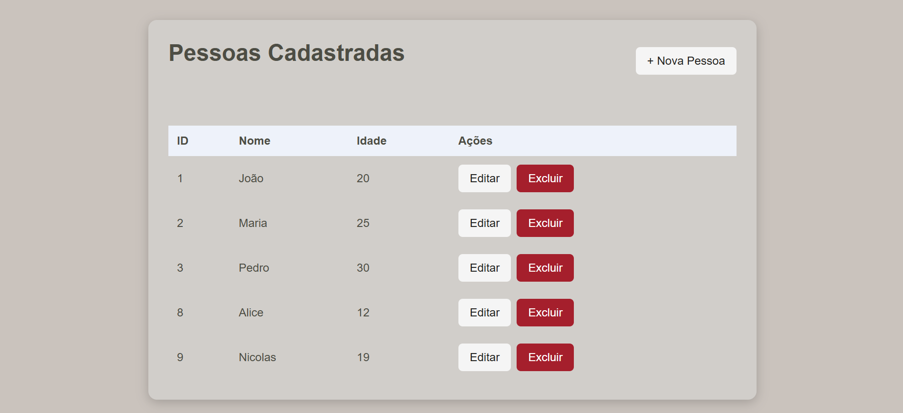
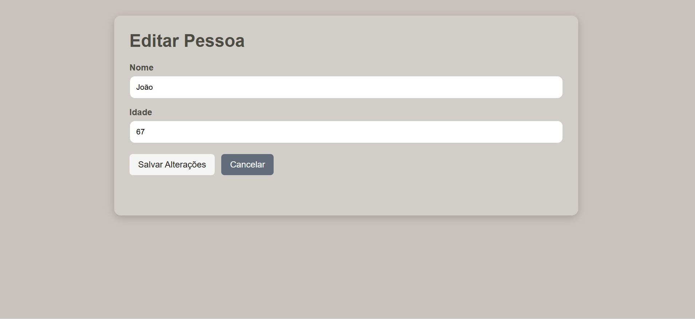
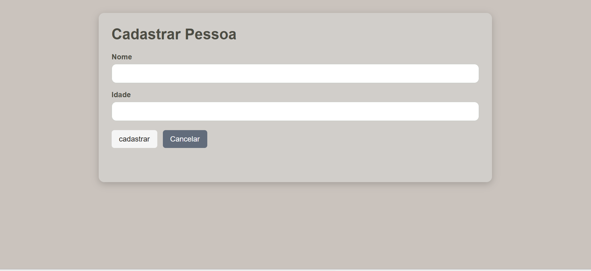
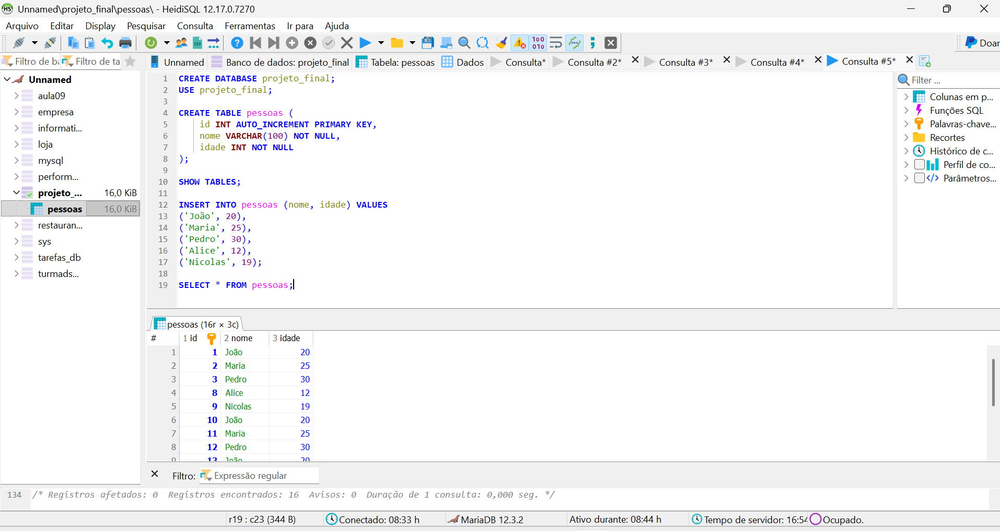

"# FrontEndFullStack" 

Front-End – Sistema de Gestão de Pessoas
Atividade 08 – Consumindo o Back-End no Front-End – CRUD

Professor: Vitor Lima Santana
Aluno(a): Alice Querino da Costa
Disciplina: Programação Back-End

1. Objetivo
Desenvolver uma aplicação Front-End utilizando HTML, CSS e JavaScript para consumir uma API REST desenvolvida em Node.js, Express e MySQL/MariaDB.

A atividade tem como foco implementar o cadastro de pessoas utilizando o método HTTP POST, a função fetch() e o tratamento de erros com async/await e try/catch.

2. Tecnologias utilizadas
HTML5
CSS3
JavaScript
Fetch API
Async/Await
Try/Catch
Node.js e Express (Back-End)
MySQL/MariaDB (Banco de dados)
3. Estrutura do projeto
frontend-gestao-pessoas/
│
├── index.html
├── cadastro.html
├── editar.html
│
├── css/
│   └── style.css
│
├── js/
│   ├── listar.js
│   ├── cadastro.js
│   └── editar.js
│
└── README.md
4. Funcionalidades
O sistema possui as seguintes operações:

Método	Rota	Funcionalidade
GET	/pessoas	Listar pessoas
GET	/pessoas/:id	Consultar pessoa
POST	/pessoas	Cadastrar pessoa
PUT	/pessoas/:id	Atualizar pessoa
DELETE	/pessoas/:id	Excluir pessoa
5. Implementação do POST
O aluno deverá desenvolver o arquivo js/cadastro.js, responsável por capturar os dados do formulário HTML e enviá-los para a API.

A implementação deverá utilizar:

addEventListener("submit", ...)
preventDefault()
async/await
try/catch
fetch()
method: "POST"
JSON.stringify()
Verificação de resposta.ok
Exemplo da estrutura de requisição
const resposta = await fetch(
  "http://localhost:3000/pessoas",
  {
    method: "POST",
    headers: {
      "Content-Type": "application/json"
    },
    body: JSON.stringify({
      nome,
      idade
    })
  }
);
O código deverá estar dentro de uma função assíncrona, com tratamento de erros utilizando try/catch.

O aluno também deverá validar os campos nome e idade antes de enviar os dados.

6. Como executar
Back-End
Realizar o Fork do repositório original disponibilizado pelo professor.
Clonar o repositório.
Instalar as dependências:
npm install
Configurar a conexão com o banco de dados.
Iniciar a API:
npm start
A API estará disponível em:

http://localhost:3000

Front-End
Abrir o projeto no Visual Studio Code.
Verificar se o Back-End está funcionando.
Executar index.html com o Live Server.
Acessar a página de cadastro.
Cadastrar uma pessoa.
Verificar se os dados foram armazenados no banco de dados.

7. Evidências
Adicione capturas de tela demonstrando:

Imagem 1 – Tela de listagem

Imagem 2 – Formulário de cadastro

Imagem 3 – Cadastro funcionando

Imagem 4 – Registro inserido no banco de dados

8. Repositórios
Back-End (Fork): [https://github.com/AliceCosta20/ProjetoFullStack.git]

Front-End: [(https://github.com/AliceCosta20/Aula-09.git)]

9. Conclusão do aluno
Explique com suas palavras:

Como funciona a comunicação entre o Front-End e o Back-End?
A comunicação ocorre através do HTTP utilizando o cliente-servidor. O Front-End(Cliente) envia informações como POST, GET, PUT e DELETE, para endpoints de uma API REST no Back-End (servidor). Através desse processo, o Back-End processa essas requisições, interage com a base de dados e devolve uma resposta em formato JSON.

Qual é a finalidade do método POST?
Esse método tem a função de enviar os dados a partir do cliente para o servidor para criar um novo recurso na base de dados (Cadastrar ou registrar um produto).

Por que utilizamos async/await e try/catch?
Async/Await são palavras-chaves que servem para operações que demoram a responder (assíncronas).
Enquanto o try/catch é utilizado para tratar dos erros durante a execução dos processos assíncronas. Por exemplo, se uma requisição falhar, seja por uma rede ou erro de servidor, o bloco catch captura o erro e impende que essa aplicação piore.

Quais dificuldades você encontrou durante a atividade?
Durante a realização da atividade, a principal dificuldade foi compreender o fluxo de envio e recebimento de dados entre as requisições do Front-End e as rotas do Back-End, além de tratar adequadamente os erros com try/catch para garantir o bom funcionamento da interface em casos de falha na API.

Créditos
Professor responsável: Vitor Lima Santana

Desenvolvido por: Alice Costa

Atividade 08 – Desenvolvimento Web e Consumo de APIs REST"# Aula-09" 
